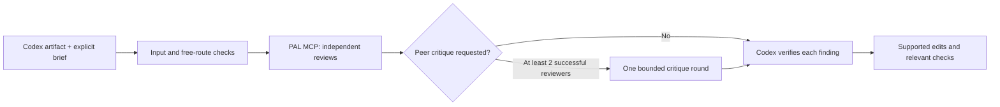

# PAL Review Skill

[](https://github.com/Kimhyuntae9665/pal-review-skill/actions/workflows/tests.yml)

**A Codex skill that asks other model families to review an artifact, optionally
critique each other's evidence, and feeds the findings back to Codex for checked improvements.**

[한국어](README.md) · [Operations](references/operation.md) · [Architecture](docs/ARCHITECTURE.md) · [Security](SECURITY.md)

Codex authors the work. External models advise. The current Codex task checks each
finding against the source or tests, adopts or rejects it with evidence, makes
supported changes, and validates the result. Model agreement does not prove
correctness. The CLI does not automatically launch another Codex or edit files.



The illustrated [workflow](docs/assets/review-workflow.png) and
[mode comparison](docs/assets/review-vs-debate.png) use Korean labels.
An [English interactive HTML viewer and diagram sources](docs/diagrams/README.md)
are included; download the HTML to open it in a browser.

## Modes and default providers

| Mode | Behavior | Maximum inference calls |
|---|---|---:|
| `review` | Independent review of the same source snapshot | 4 |
| `debate` | Independent review plus one peer critique per successful reviewer | 8 |

Debate requires two successful, identity-confirmed first-round reviewers. Failed,
truncated, malformed or identity-unverified reports are not forwarded as evidence.
There are no automatic retries, paid substitutions or provider fallbacks.

The free profile currently configures these exact routes:

| Service | Model ID |
|---|---|
| Google Free Tier | `gemini-3.8-flash` |
| Groq Free Plan | `qwen/qwen3.8-27b` |
| OpenRouter | `nvidia/nemotron-3-ultra-550b-a55b:free` |
| OpenRouter | `cohere/north-mini-code:free` |

Free access is conditional, limited and subject to change. Google/Groq require an
unbilled Free account/project confirmation. OpenRouter requires the exact `:free`
ID and zero numeric catalog prices before inference. Its free endpoints share an
account quota; they do not each grant a new allowance. Check the current
[Google pricing](https://ai.google.dev/gemini-api/docs/pricing),
[Groq limits](https://console.groq.com/docs/rate-limits) and
[OpenRouter limits](https://openrouter.ai/docs/api_reference/limits).
The model list is not a review-quality leaderboard or a claim of parity with paid models.

## Install on Windows

Requirements: Git, Python 3.11+, and keys for the services you choose. No local
model weights, Ollama, GPU or Node.js are needed for review execution. Windows is
the primary tested platform; Linux/environment-variable use is experimental.

```powershell
$codexRoot = if ($env:CODEX_HOME) { $env:CODEX_HOME } else { Join-Path $HOME '.codex' }
$skillRoot = Join-Path $codexRoot 'skills/pal-review'
git clone https://github.com/Kimhyuntae9665/pal-review-skill.git $skillRoot
Set-Location $skillRoot
python scripts/bootstrap.py --check
python scripts/bootstrap.py
& ./scripts/pal-review.ps1 doctor
```

Preserve an existing installation instead of overwriting it. Bootstrap downloads
the official pinned PAL checkout and installs a local `.runtime/venv`. It does
not create accounts, connect keys, change global MCP configuration or call models.

Create your own keys in [Google AI Studio](https://aistudio.google.com/api-keys),
[Groq](https://console.groq.com/keys) and/or [OpenRouter](https://openrouter.ai/settings/keys).
Never put them in chat, command arguments or source files. Use the hidden local prompts:

```powershell
& ./scripts/pal-review.ps1 connect gemini
& ./scripts/pal-review.ps1 connect groq
& ./scripts/pal-review.ps1 connect openrouter
& ./scripts/pal-review.ps1 doctor
```

Windows credentials use user/machine-bound DPAPI. Google/Groq require you to
confirm Free status with paid billing disabled; this is not a billing API query
or a guarantee against a later account upgrade. No author's credentials or
private account results are included here. `doctor` readiness is not live inference success.

## Ask Codex to use it

```text
$pal-review Review this artifact with the configured free models, let them critique
each other's findings once, then verify the advice and fix supported issues.
Run the relevant checks and report what changed and what remains unresolved.
```

If newly installed skills do not appear immediately, start a new Codex task.
For a direct synthetic example from the repository root:

```powershell
& ./scripts/pal-review.ps1 rounds plan --mode debate --cwd ./tests/fixtures --brief cloud-brief.md --file cloud-example.py
& ./scripts/pal-review.ps1 rounds run --mode debate --cwd ./tests/fixtures --brief cloud-brief.md --file cloud-example.py --output-dir ./.review-runs/example-001
```

`plan` is offline. `run` sends real requests. Choose a fresh output directory each
time. Use `--models` followed by exact configured IDs for a subset. Results include
source hashes/snapshots, per-round JSON, a manifest, `REVIEW_SUMMARY.md` and
`CODEX_HANDOFF.md`. The current Codex must read the handoff and verify findings;
`review_stage_complete` only describes the review stage.

## Bounds, privacy and validation

- Explicit UTF-8 inputs only: 20,000 bytes/file and 48,000 bytes/packet; no recursive upload.
- At most one inference POST per single request; a 600-second outer deadline.
- Groq Free uses a 768-token cap and one prioritized finding; OpenRouter Free
  requests at most two findings, Gemini at most three. Caps are not remaining quota.
- No tool access for reviewers, no native unbounded continuation, no repair plugin.
- Missing usage is unknown, not zero. Remaining allowance requires an actual
  account observation, separate from returned token consumption.
- Heuristic secret checks are incomplete. NVIDIA free endpoints prohibit
  personal/confidential data; Google Free Tier may use content for product improvement.
- Text review does not verify PDF/image layout or independently run code.

```powershell
& ./.runtime/venv/Scripts/python.exe -m unittest discover -s tests -v
```

Tests include actual PAL/MCP/provider/SDK paths with mocked HTTP, synthetic
credential round trips on Windows, and boundary/identity/retry checks. They do
not measure reviewer accuracy. See [validation](docs/VALIDATION.md) and
[contributing](CONTRIBUTING.md). CI has no model keys and performs no live inference.

On 2026-10-26, GitHub CI passed all 91 tests on Windows and 90 on Linux with one
Windows-only DPAPI check skipped. Seven local numerical example checks also
passed. This is distinct from live model access or reviewer accuracy.
[Actual CI run](https://github.com/Kimhyuntae9665/pal-review-skill/actions/runs/40264813206)

This independent integration uses [PAL MCP Server](https://github.com/BeehiveInnovations/pal-mcp-server),
pinned to `7afc7c1cc96e23992c8f105f960132c657883bb1`. It does not vendor or claim
authorship of PAL. Licensed under [Apache-2.0](LICENSE); see [NOTICE](NOTICE).
