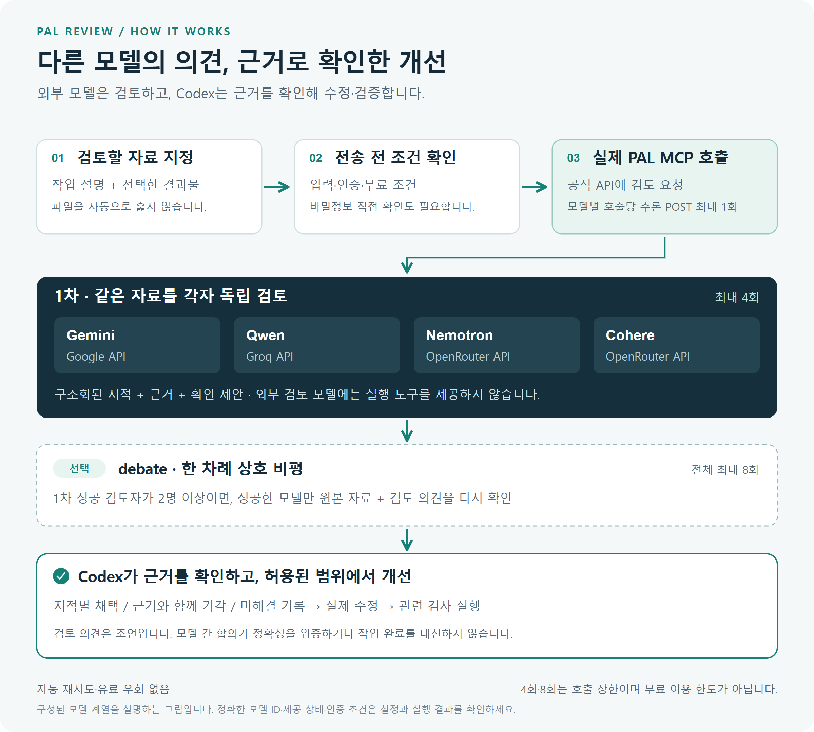
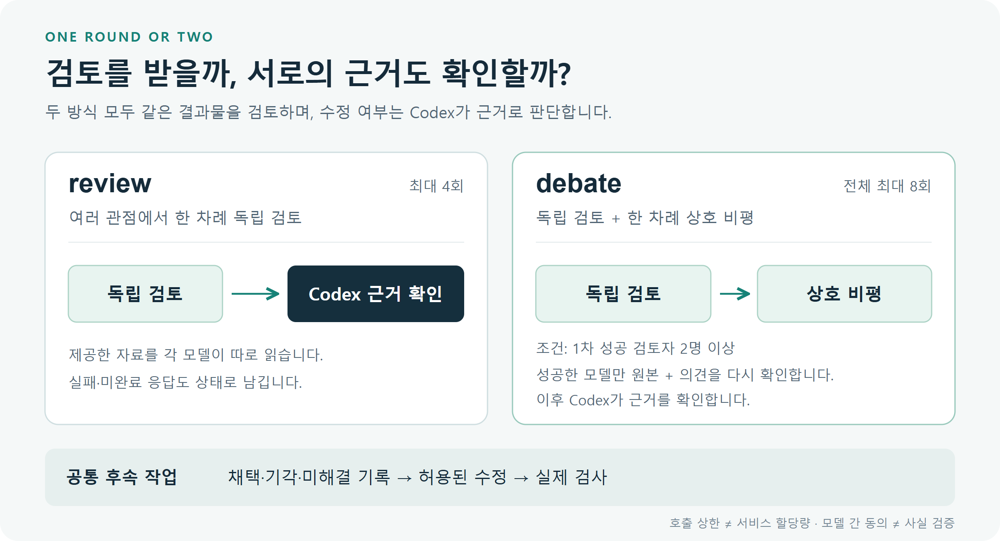

# PAL Review Skill

[](https://github.com/Kimhyuntae9665/pal-review-skill/actions/workflows/tests.yml)

**Codex가 만든 코드·문서·계획을 다른 모델로 검토하고, 확인된 의견으로 개선하는 Codex 스킬입니다.**

[English](README.en.md) · [설치·운영](references/operation.md) · [구조](docs/ARCHITECTURE.md) · [검증](docs/VALIDATION.md) · [보안](SECURITY.md)

<table>
  <tr>
    <td align="center" width="20%">
      <br>
      <strong>Codex</strong><br>
      <sub>작성 · 근거 확인 · 개선</sub>
    </td>
    <td align="center" width="20%">
      <br>
      <strong>Gemini</strong><br>
      <sub>3.8 Flash</sub><br>
      <sub>독립 검토</sub>
    </td>
    <td align="center" width="20%">
      <br>
      <strong>Qwen</strong><br>
      <sub>3.8 27B</sub><br>
      <sub>독립 검토</sub>
    </td>
    <td align="center" width="20%">
      <br>
      <strong>Nemotron</strong><br>
      <sub>NVIDIA · 3 Ultra</sub><br>
      <sub>독립 검토</sub>
    </td>
    <td align="center" width="20%">
      <br>
      <strong>Cohere</strong><br>
      <sub>North Mini Code</sub><br>
      <sub>독립 검토</sub>
    </td>
  </tr>
</table>

[모델·제공사 로고 출처와 라이선스](docs/assets/logos/README.md)

Codex가 작업을 만든 뒤 Gemini·Qwen·Nemotron·Cohere에 독립적인 검토를 요청합니다.
필요하면 모델들이 서로의 근거를 한 번 더 검토합니다. 마지막에는 **Codex가 원본과
테스트로 지적을 확인하고, 타당한 수정과 재검증까지 수행**합니다.

모델이 같은 말을 했다는 이유로 승인하지 않습니다. 지적마다 **채택 / 근거를 들어 기각 /
미해결**을 남깁니다. 검토 보고서를 받는 것과 원래 작업을 완료하는 것은 구분합니다.



[도식 원본과 선택 가능한 HTML 보기](docs/diagrams/README.md)도 포함했습니다.
GitHub에서는 PNG를 읽고, HTML은 내려받아 브라우저에서 열 수 있습니다.

## 무엇을 할 수 있나요?

- 코드의 계산·예외 처리·요구사항 누락, 문서의 근거 부족, 계획의 가정을 다른 관점에서 검토합니다.
- 같은 결과물을 여러 모델이 각각 읽거나, 한 차례 서로의 의견을 비평하게 합니다.
- 요청한 모델과 실제 응답 모델, 성공·실패, 입력 파일 해시, 제공된 토큰 사용량을 보존합니다.
- 모델 의견을 Codex에 돌려줘 근거 확인 → 수정 → 관련 점검으로 이어갑니다.

현재 검토 대상은 **선택한 UTF-8 텍스트·코드**입니다. PDF·이미지의 시각적 배치는
검증하지 않으며, 외부 검토 모델에는 파일 탐색·브라우저·명령 실행 도구를 주지 않습니다.

## 검토와 토론의 차이



| 모드 | 처리 | 추론 호출 상한 |
|---|---|---:|
| `review` | 같은 자료를 모델별로 독립 검토 | 선택한 모델당 1회, 최대 4회 |
| `debate` | 독립 검토 + 자신의 이전 의견과 동료 의견에 대한 비평 | 전체 최대 8회 |

토론은 **1차 검토가 정상 완료된 모델이 2개 이상**일 때만 진행합니다. 실패·미완료·모델
식별 불일치 응답은 동료 근거로 전달하지 않습니다. 4회·8회는 프로그램의 호출 상한이며
서비스의 무료 할당량이 아닙니다. 호출은 순차 실행하며 자동 재시도·유료 우회는 없습니다.

## 기본 무료 경로

| 모델 | 실제 호출 서비스 / 정확한 ID | 필요한 계정 |
|---|---|---|
|  **Gemini 3.8 Flash** | Google API · `gemini-3.8-flash` | Google AI Studio Free 프로젝트 |
|  **Qwen3.8 27B** | Groq · `qwen/qwen3.8-27b` | Groq Free 조직 |
|  **Nemotron 3 Ultra** | OpenRouter · `nvidia/nemotron-3-ultra-550b-a55b:free` | OpenRouter |
|  **Cohere North Mini Code** | OpenRouter · `cohere/north-mini-code:free` | 위와 같은 OpenRouter 계정·키 |

**무료는 무제한을 뜻하지 않습니다.** 계정·지역·용량·제공사 정책에 따라 접근과 한도가
달라집니다. Google/Groq는 유료 결제를 연결하지 않은 Free 플랜인지 직접 확인해야 합니다.
OpenRouter는 정확한 `:free` ID와 현재 카탈로그의 모든 숫자 가격이 0인지 검사합니다.
이 검사는 서비스 측 결제 상태를 고정하거나 미래의 무료 제공을 보장하지 않습니다.

2026-10-26 공식 문서 확인 기준, Groq는 공개 기본 한도와 별개로 조직별 제한이 적용될 수
있고, OpenRouter의 무충전 무료 모델은 50회/일을 공유합니다. Nemotron과 Cohere의 한도는
각각 50회가 아닙니다. 정확한 잔여량은 본인 콘솔이나 실제 계정 조회 응답으로 확인하세요.
[Google 가격](https://ai.google.dev/gemini-api/docs/pricing) ·
[Groq 한도](https://console.groq.com/docs/rate-limits) ·
[OpenRouter 한도](https://openrouter.ai/docs/api_reference/limits)

## 빠른 시작 — Windows

준비물: **Git, Python 3.11 이상, 사용할 서비스의 API 키**. Node.js·Ollama·로컬 GPU는
리뷰 실행에 필요하지 않습니다. 모든 모델을 연결할 필요 없이 한 경로부터 시작할 수 있습니다.
Windows에서 직접 시험했으며, Linux는 환경변수 방식과 CI를 구성한 실험적 지원입니다.

### 1. Codex 스킬 폴더에 설치

PowerShell에서 실행합니다. 같은 경로에 기존 스킬이 있으면 덮어쓰지 말고 먼저 보관하세요.

```powershell
$codexRoot = if ($env:CODEX_HOME) { $env:CODEX_HOME } else { Join-Path $HOME '.codex' }
$skillRoot = Join-Path $codexRoot 'skills/pal-review'
git clone https://github.com/Kimhyuntae9665/pal-review-skill.git $skillRoot
Set-Location $skillRoot

python scripts/bootstrap.py --check
python scripts/bootstrap.py
& ./scripts/pal-review.ps1 doctor
```

`python`이 Microsoft Store 안내만 열면 실제 Python 3.11+ 인터프리터를 사용하세요.
`uv`를 이미 쓴다면 `uv run --python 3.11 --no-project python scripts/bootstrap.py`도 가능합니다.

설치기는 저장소의 `.runtime/`에 PAL 원본과 격리된 Python 환경을 만듭니다. upstream 커밋을
고정하고 설치 상태를 검사하며, 기존의 알 수 없는 환경이나 수정된 PAL을 덮어쓰지 않습니다.
코드·패키지를 다운로드하지만 모델 추론이나 API 키 등록은 하지 않습니다.

### 2. 필요한 서비스만 연결

[Google AI Studio](https://aistudio.google.com/api-keys), [Groq](https://console.groq.com/keys),
[OpenRouter](https://openrouter.ai/settings/keys)에서 본인의 키를 발급받습니다.
키를 채팅·명령 인자·소스에 넣지 말고 **로컬의 숨김 입력창**에 입력하세요.

```powershell
& ./scripts/pal-review.ps1 connect gemini
& ./scripts/pal-review.ps1 connect groq
& ./scripts/pal-review.ps1 connect openrouter
& ./scripts/pal-review.ps1 doctor
```

Google/Groq 연결은 Free·유료 결제 비활성 상태를 확인한 뒤 `FREE`를 입력하게 합니다.
Windows 키 저장은 현재 사용자와 PC에 묶인 DPAPI 암호화를 사용합니다. 이 저장소에는
작성자의 키·계정·잔여량·개인 작업 결과가 포함되어 있지 않습니다.
`doctor`의 `ready`는 준비 상태이며 실제 모델 응답 성공을 뜻하지 않습니다.

### 3. Codex에 요청

새 작업에서 스킬이 보이면 다음처럼 요청합니다. 바로 보이지 않으면 새 Codex 작업에서
다시 확인하세요. 스킬을 읽는 것만으로 외부 검토가 실행된 것으로 취급하지 않습니다.

```text
$pal-review 지금 만든 결과물을 무료 네 모델로 검토해줘.
의견을 서로 한 번 더 검토하게 하고, 근거가 맞는 내용만 반영해서
수정과 테스트까지 진행해줘.
```

토론이 필요 없다면 “독립 검토만 하고 확인된 문제를 고쳐줘”라고 요청하면 됩니다.

## 명령으로 직접 실행

아래 예제는 공개 가능한 **가상 코드**만 보냅니다. `plan`은 네트워크·추론을 호출하지 않습니다.
`run`은 연결한 서비스에 실제 API 요청을 보냅니다. 출력 폴더는 매번 새 경로를 사용합니다.

```powershell
# 저장소 루트에서
& ./scripts/pal-review.ps1 rounds plan --mode debate --cwd ./tests/fixtures --brief cloud-brief.md --file cloud-example.py

& ./scripts/pal-review.ps1 rounds run --mode debate --cwd ./tests/fixtures --brief cloud-brief.md --file cloud-example.py --output-dir ./.review-runs/example-001
```

모델을 좁히려면 `--models` 뒤에 표의 정확한 ID를 나열하세요. 한 모델만 선택한 토론은
동료가 없어 2차 호출을 생략합니다. `.review-runs/`와 `.runtime/`은 Git에서 제외됩니다.

실행 결과에는 다음이 남습니다.

```text
.review-runs/example-001/
  manifest.json          # 요청 모델, 단계별 상태, 소스 해시
  round-1-model-*.json    # 제공사 메타데이터, 실제 응답, 해석된 지적
  round-2-model-*.json    # 토론이 실행된 경우
  REVIEW_SUMMARY.md      # 모델별 입력/출력/총 토큰, 누락된 값
  CODEX_HANDOFF.md       # Codex가 읽고 근거 확인·개선할 전달 문서
  sources/               # 이번 검토의 원본 스냅샷
```

`review_stage_complete`는 예정한 검토 응답이 수신됐다는 뜻입니다. 원래 작업의 정답이나
수정 완료를 뜻하지 않습니다. CLI만 실행하면 Codex를 새로 띄우거나 파일을 자동 수정하지
않습니다. **스킬을 사용하는 현재 Codex가 전달 문서를 읽고, 확인된 수정을 수행**합니다.

## 실제로 어떤 개선을 하나요?

예제의 원래 코드는 `sum(price) / sum(quantity)`를 계산합니다. 요구사항은
`sum(price * quantity) / sum(quantity)`이며, 전체 수량이 0이면 `0.0`을 반환해야 합니다.

| 입력 | 원래 코드 | 요구 결과 |
|---|---:|---:|
| `[(10, 2), (100, 1)]` | 약 36.67 | 40.0 |
| `[]` | `ZeroDivisionError` | 0.0 |

Codex는 지적을 직접 재현하고 분자에 수량을 곱하며 0 수량 분기를 추가할 수 있습니다.
검수 모델의 산술 예시나 추가 요구가 틀리면 그 부분은 기각해야 합니다. 이것은 작은 기능
시험이며 모델의 검수 정확도·순위·유료 모델과의 동등성을 입증하는 벤치마크가 아닙니다.

## 제한과 안전장치

- 입력 파일당 20,000바이트, 전체 패킷 48,000바이트. 초과하면 조용히 자르지 않고 실패합니다.
- 단일 요청은 추론 POST 최대 1회·최대 600초. 자동 재시도·제공사 우회·유료 전환은 없습니다.
- Groq Free는 출력 768토큰·짧은 지적 1개, OpenRouter Free는 지적 최대 2개,
  Gemini는 최대 3개를 요청합니다. 출력 제한은 남은 토큰량이나 성공 보장이 아닙니다.
- 잘린 응답·잘못된 JSON·확인되지 않은 모델 식별은 완료된 검토로 승인하지 않습니다.
- HTTP 503은 제공사 가용성, 429는 한도 문제일 수 있습니다. 실패 기록은 보존합니다.
- 비밀 패턴 검사는 보조 수단입니다. NVIDIA 무료 경로에 개인정보·기밀을 보내면 안 되며,
  Google 무료 등급도 제품 개선에 내용을 사용할 수 있습니다. 공개·가상 자료부터 사용하세요.

고급 단일 검토의 `quality` 프로필은 유료 모델 설정입니다. 무료 모드와 구분되며
명시적인 `--allow-paid` 없이는 실행하지 않습니다. 이 저장소는 결제나 업그레이드를 수행하지 않습니다.

## 검증과 개발

```powershell
& ./.runtime/venv/Scripts/python.exe -m unittest discover -s tests -v
```

테스트는 가짜 HTTP 응답과 가상 입력을 사용합니다. 실제 PAL MCP·제공사 어댑터·SDK를 거치는
시험도 포함하지만 **외부 모델의 실제 추론이나 검수 성능 시험과는 구분**합니다.
CI에 API 키가 필요하지 않습니다. 자세한 실행 결과와 재현 방법은 [검증 기록](docs/VALIDATION.md)을 보세요.
2026-10-26 GitHub에서 **Windows 91개 통과, Linux 90개 통과·Windows 전용 1개 생략**을
확인했습니다. 예제 계산 7개도 로컬에서 통과했습니다. [실제 CI 기록](https://github.com/Kimhyuntae9665/pal-review-skill/actions/runs/40264813206)

이 프로젝트는 [PAL MCP Server](https://github.com/BeehiveInnovations/pal-mcp-server)의
실제 MCP 실행 경로를 사용하는 별도의 Codex 스킬·연결 코드입니다. PAL을 직접 만든 프로젝트로
표시하지 않으며 upstream 소스는 이 저장소에 복제해 배포하지 않습니다.

**라이선스:** [Apache-2.0](LICENSE). 출처와 제3자 조건은 [NOTICE](NOTICE),
기여 방법은 [CONTRIBUTING.md](CONTRIBUTING.md)를 확인하세요.
